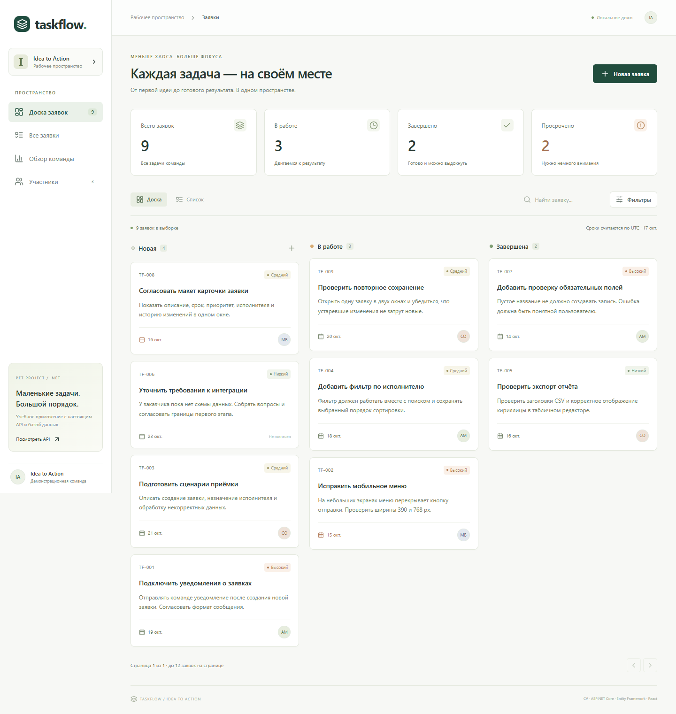

# TaskFlow

**A small team request tracker built with C#, ASP.NET Core, Entity Framework Core and React.**

TaskFlow turns incoming requests into assigned, traceable work. It is a self-initiated portfolio / learning project created with AI assistance, not paid client work. Team members and seeded tasks are fictional.



## What you can do

- Create and edit requests with descriptions, priorities, assignees and due dates.
- Move work from New → In progress → Done, or reopen it.
- Search, combine filters, sort and paginate on the server.
- Inspect a persistent change history.
- Detect stale updates with optimistic concurrency (HTTP 409).
- View team totals and overdue work; export a CSV report.
- Use a responsive React interface on desktop and mobile.

## Stack

| Area | Implementation |
|---|---|
| Backend | C#, ASP.NET Core 10, minimal REST endpoints, DI, Problem Details |
| Persistence | EF Core 10, SQLite by default, checked-in SQLite migrations |
| Optional database | PostgreSQL through Npgsql; fresh schema setup, separate verification required |
| Frontend | React 19, Vite, Lucide icons, plain CSS |
| Async / TPL | Async database I/O, CancellationToken, Task.WhenAll with independent DbContexts |
| Tests | xUnit rules + API integration tests with real temporary SQLite databases |
| CI | GitHub Actions definition: build UI, build .NET, run tests, upload TRX |

## Run locally

Requirements: **.NET 10 SDK**. The prebuilt React interface is included, so Node.js is not needed just to run the app.

```sh
dotnet run --project src/TaskFlow.Api --urls http://127.0.0.1:5080
```

Open **http://127.0.0.1:5080**. The database is created/migrated on startup, and demo rows are seeded into a new database. Subsequent starts preserve your changes.

On this prepared Windows workspace, `Start TaskFlow.cmd` also detects the locally installed SDK in `.tools/dotnet`. That SDK is not part of the source distribution.

## Build the interface

Node.js 22+ and pnpm 11.25.0:

```sh
cd frontend
pnpm install --frozen-lockfile
pnpm run build
```

Vite writes the output into `src/TaskFlow.Api/wwwroot`. Development mode: run the API on port 5080, then `pnpm dev` from `frontend`. API requests are proxied by Vite.

## Test

```sh
dotnet test TaskFlow.sln
```

Windows with the prepared SDK: `./test.ps1`.

Integration tests use isolated temporary SQLite files; they never use or reset your demo database. Browser tests are in `frontend/tests/e2e.mjs` and require a running disposable test instance (`TASKFLOW_BASE_URL`). Install the browser for Playwright before running them on a new machine.

## API

| Method | Endpoint | Purpose |
|---|---|---|
| GET | `/api/health` | Database readiness |
| GET | `/api/workspace` | Team + summary, concurrent isolated reads |
| GET | `/api/team` | Demo team members |
| GET | `/api/items` | Query / filter / sort / page |
| GET | `/api/items/{id}` | Item and concurrency version |
| POST | `/api/items` | Create a request; 201 + Location |
| PUT | `/api/items/{id}` | Update fields; version required |
| PATCH | `/api/items/{id}/status` | Transition status; version required |
| GET | `/api/items/{id}/history` | Change history |
| GET | `/api/reports/summary` | Totals, high-priority open work, overdue |
| GET | `/api/reports/export` | Download CSV |
| GET | `/openapi/v1.json` | Machine-readable OpenAPI document |

Examples: [docs/API.http](docs/API.http). Architecture, data model, concurrency and tradeoffs: [docs/ARCHITECTURE.md](docs/ARCHITECTURE.md). SQL examples: [docs/queries.sql](docs/queries.sql). Russian study guide: [docs/INTERVIEW-GUIDE.md](docs/INTERVIEW-GUIDE.md).

## PostgreSQL option

After building the UI, set `TASKFLOW_DB_PASSWORD` in your shell, then `docker compose up --build`. The application port is bound only to 127.0.0.1. Alternatively set `Database__Provider=Postgres` and `ConnectionStrings__Postgres` before starting .NET. Use a fresh demo database: this mode uses EnsureCreated, not the SQLite migration chain.

Docker / PostgreSQL validation status is recorded in the verification notes; do not assume it was tested merely because configuration is included.

## Boundaries

This is a local demo without authentication, permissions or tenant isolation. It is **not ready for public use with real data**. All local users share the same data. No external notification integration, payments or account management is claimed. SQLite case-insensitive search is ASCII-only; Cyrillic case folding is a known limitation. Deadlines use UTC dates.

CI is provided as source; a successful local run does not claim that a GitHub-hosted workflow has executed. Performance targets in the architecture document are targets, not established production measurements.

## Repository map

```text
src/TaskFlow.Api/
  Domain/                 Entities and pure validation rules
  Services/               Use cases, query logic, async aggregation
  Data/                   EF mapping, seed and migrations
  wwwroot/                Prebuilt React application
tests/TaskFlow.Tests/      Unit and API integration tests
frontend/src/             React source and CSS
frontend/tests/           Browser tests
docs/                     Screenshots, SQL, API examples and study notes
.github/workflows/        CI definition
```
