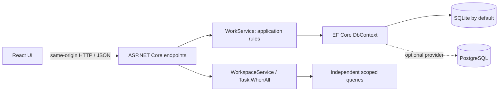
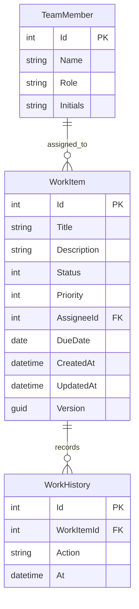

# TaskFlow: design decisions

TaskFlow is a self-initiated portfolio application, not a commissioned product.

## Scope and assumptions

One developer now and for the next year, a small internal demonstration team, per-change CI, zero monthly hosting budget. Default deployment is loopback-only. No internet-facing service is provisioned.

Targets, not measured guarantees: local API p50 <100 ms / p95 <300 ms / p99 <700 ms with 1,000 rows; mobile LCP <2.5 s / INP <200 ms / CLS <0.1; hypothetical hosted availability objective 99.5%. No production SLO or mobile-4G benchmark has been established. These targets require a dedicated environment and load measurements before claiming compliance.

## Components

The project is a small monolith. Domain rules, persistence and application services have separate folders. A repository wrapper around EF Core would duplicate its existing abstraction without solving a current problem. Dependency injection uses IWorkService; TimeProvider allows deterministic time-sensitive tests.

## Data model

Assignee is optional while New, required for InProgress and Done. Valid transitions: New → InProgress; InProgress → New or Done; Done → InProgress. Direct New → Done is rejected. Overdue means due date is earlier than today's UTC date AND item is not Done; due today is not overdue.

## Persistence and concurrency

SQLite migrations are checked in. PostgreSQL is optional and creates the schema from the EF model on a fresh database; this demo does not provide a PostgreSQL migration chain. Switching providers requires a fresh database, not copying a SQLite file. Never use EnsureCreated alongside migrations on the same database.

WorkItem.Version is a GUID concurrency token. PUT/PATCH require the version seen by the client. Stale requests get HTTP 409; the database token also catches races after the precheck. Item mutation and history insertion share a single SaveChanges transaction. Idempotent status requests do not add duplicate history entries. This is optimistic concurrency, not a row-locking system.

Search uses parameterized LINQ and a bounded query length, stable ordering, server pagination and a page-size cap of 100. SQLite's built-in lower() handles ASCII, not full Unicode case folding; Cyrillic search is case-sensitive where case differs. PostgreSQL has different collation behavior. A production search feature needs a deliberate locale/collation strategy. Dates have UTC semantics. CSV export quotes fields and prefixes formula-looking text.

## Async and TPL

Database I/O uses async EF methods with request CancellationToken. WorkspaceService uses Task.WhenAll for independent team and summary reads, each in a separate DI scope. Parallel EF operations on one DbContext are deliberately avoided. Task.Run is not used to disguise I/O as background work.

## Frontend

React + Vite, no hosted fonts or image dependencies. Neutral canvas, forest-green navigation and muted status colors. Desktop board becomes vertically stacked columns on small screens. The application shows real API failures rather than silently substituting fixtures. AbortController cancels stale searches. The dialog supports native keyboard dismissal. No ornamental continuous motion; prefers-reduced-motion disables transitions.

## Limits before real deployment

No authentication, authorization, accounts or tenant isolation. All local users can edit all demo items. UI names are fictional. Do not put this application on a public host with real data without implementing access control, TLS, deployment secrets, CSRF/origin strategy as appropriate, backups, operational limits and PostgreSQL migrations. Export materializes all items and is intended for a small demonstration dataset. It is not a background export system.
